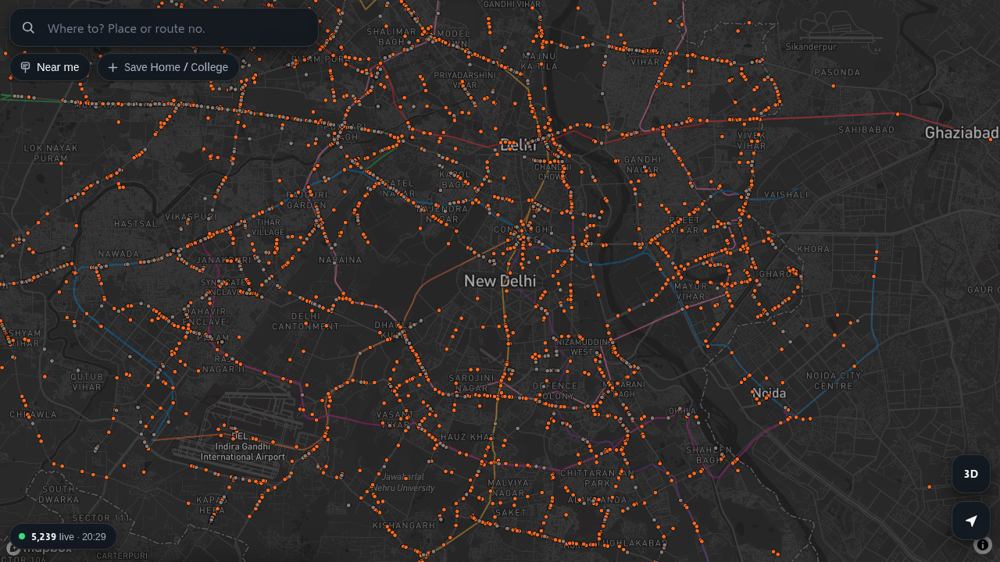

# Delhi Bus Tracker

Live at https://bus.shreyanshs.xyz

Live map of Delhi's buses with a destination search and a walk + bus + metro trip planner. Built on the Delhi government's Open Transit Data (GTFS-RT) feed and Mapbox. Static frontend, no framework; small Node API on Vercel.

## What it does
- **Live map**: every bus reporting to the feed (~4,500-5,500) on a dark Mapbox map, polled every 10 s. Buses move continuously (see *How buses move*). Zoomed out they are dots, then heading markers with route chips, and from zoom 13.6 instanced 3D buses facing their direction of travel.
- **3D bus stops**: shelters at the real stops from zoom 15.2, turned to face the road; flat stop dots from 13.5; nothing further out. Tap one for its live arrivals.
- **Search places or routes** in one box: "Dyal Singh College", "Nehru Place", "534", "AIRPORT". Local results (metro stations, landmarks, bus stops) appear instantly; Mapbox Search Box POIs (bounded to Delhi NCR, biased to your location) follow.
- **Destination results**: every direct route from a stop near you (≤850 m) to a stop near the destination (≤650 m), best total time first. Each option shows the board stop and walk, the next catchable bus (live prediction or position estimate), ride time, get-off stop and final walk. Only the live buses on those routes that are heading toward the destination and have not passed it stay on the map. Tap an option to highlight its route, buses and walking legs, then follow the next bus.
- **Trip planner**: when there is no direct bus, or a metro route is much faster, it offers journeys with a change (bus+bus, bus+metro, metro+metro) as step-by-step cards drawn on the map. Bus legs are live; **metro legs are scheduled only** (labelled "Scheduled", no live metro times or countdowns).
- **Bus sheet**: tap a bus for direction, progress, next stops with live predicted times, delay vs timetable, bunching, Follow, whole route, share trip. Tap a stop to mark where you get off; tap its bell to be alerted.
- **Saved places**: Home / PG, College and any number of custom places (stored in `localStorage` on the phone only). One tap on a chip shows which bus to take right now (same results as a search, with the planner's change options). Chips get an amber dot when the last bus is near.
- **Bus-near alert**: "Alert me" on a result (any bus of that route reaching your stop) or the bell on a stop in the bus sheet (that bus). When the bus is 2 stops away you get an in-app alert (amber bar, vibration) and, if you allowed notifications, a system notification. **This is not server web push**: it works while the app is open (and briefly in the background on Android). Real push would need a push service and a server watching buses continuously; Vercel Hobby has no long-running jobs or frequent cron.
- **Fares**: estimated fare on every option and step (see *Fares*).
- **Share trip**: "I'm on bus 623 towards Shahdara Terminal, getting off at Pragati Vihar around 08:40. Track it live: …#bus=DL1PD…" through the phone's share sheet (copy-to-clipboard fallback).
- **Delay and bunching hints**: "running 12 min late / 3 min early (vs timetable)" from the trip-update `delay` field, "two 623s bunched together", "next 623 behind is about 21 min back", "another right behind" in stop arrivals.
- **Last-bus warning**: "Last 534 from here is around 22:40, in 35 min" / "No more 534 from here today" from the route's last departure plus running time to your stop.
- **Install to home screen (PWA)**: manifest, icons (incl. maskable and Apple touch icon), standalone display, dark theme colour, safe-area insets, a network-first service worker. Android/desktop Chrome get an "Install app" chip; iPhone Safari gets a short "Share → Add to Home Screen" guide.
- **Near me / stops**: nearest stops with the next buses; tap any stop for its arrivals.
- **Feed health**: status pill shows the count, last update and an "updating" pulse; banners for backup feed, stale data, demo mode, or offline.
- Deep links: `#bus=<id>`, `#near=<lat>/<lon>`, `#3d`, `#route=<no>`, `#from=<lat>/<lon>&to=<place>` (e.g. `#from=28.5686/77.2206&to=Dayal Singh College`).

## Setup
1. `npm install`
2. Copy `.env.example` to `.env` and fill in:
   - `OTD_API_KEY` - private key from https://otd.delhi.gov.in/data/realtime/ (optional locally: without it the reclaim mirror is used)
   - `MAPBOX_TOKEN` - public token from https://console.mapbox.com/
3. `npm start` and open http://localhost:3000 (try http://localhost:3000/#3d)
4. Planner check (offline, no server): `node scripts/check-planner.js 10:00`
5. Icons: `node scripts/make-icons.js` regenerates `public/icons/`

## Deploy (Vercel)
Zero-config: `public/` is served statically and `api/*.js` run as serverless functions. Set `OTD_API_KEY` and `MAPBOX_TOKEN` in the Vercel project. Pushing a branch deploys a preview.

## API
- `GET /api/vehicles` - `{source, demo, mirror, stale, count, updated, feed_ts, median_age_s, errors, buses:[...]}`
- `GET /api/vehicles?v=2` - same data in a compact form the app uses (route-id dictionary, 1e-5 integer coordinates; ~66 KB gzipped vs ~117 KB)
- `GET /api/arrivals?stop_id=…` / `?stop_ids=a,b,c` / `?vehicle_id=…` - live predictions from trip updates, each with `delay` (seconds vs timetable)
- `GET /api/config` - public Mapbox token

### Feed robustness (`lib/feed.js`)
OTD feed (key) → reclaim mirror → last good payload (served with `stale: true` for up to 30 min) → demo simulation (only if there was never any data). A source is rejected if it returns fewer than 50 buses or its header timestamp is over 8 minutes old. Buses outside Delhi NCR, duplicates, and positions older than 30 minutes are dropped. Concurrent requests share one upstream fetch; the function keeps a copy for 6 s and the CDN for 5 s (+5 s while revalidating). Error messages never include the API key. Each bus also carries its previous distinct fix (`prev` / compact row index 7) so a freshly opened app can animate immediately.

### How buses move
GPS fixes reach us 25-40 s after they are taken (some much later) and each bus reports every 10-120 s, irregularly. The app therefore replays **each bus at its own delay**: how late its fixes arrive plus the longest of its recent gaps between fixes (15-90 s; it rises at once and falls slowly). That moment almost always falls between two real fixes, and the bus is interpolated straight between them (consecutive GPS fixes are on the road; the route data is stop-to-stop straight lines that would cut through blocks). If no newer fix exists yet it keeps going along its heading at its last speed for up to 25 s, then holds. Fixes older than what the app already has (another server instance) are ignored, and big corrections are chased at ~10 m/s instead of snapped. `?debug=motion` exposes the model for measurement.

The trade-off: buses are drawn about a minute in the past (median 62 s, at most 90 s; the feed itself is ~30 s old), in exchange for continuous movement with no jumps or backtracking. Arrival times, alerts and "next bus" use the newest fix, not the replayed position.

Measured on the preview with the live OTD feed, from page load, 62 s, 76 buses on the Ring Road near AIIMS, 2 samples/s: 84% of samples show movement for buses that travelled >100 m, median longest pause 6.5 s (p90 24 s, including real stops at signals), median step 5.7 m per 0.5 s (largest 23.9 m, a correction being chased). Rendered positions on the map changed a median 37 times per bus in 30 s, even in a throttled browser at ~2 frames/s. Before the fix, buses moved for ~16 s after each update and then stood still.
Before the fix the engine glided to each new fix in 16.5 s and then held, 30-40% of buses had no new fix in a given payload, and a 15 s poll often hit the CDN's stale copy, so buses moved, stopped and moved again.

## Data
All static data uses reclaim.city IDs, which match the live feed. The 2023 DTC archive GTFS is **not** used for routing.

| File | What | Built by |
|---|---|---|
| `public/data/stops.json` | 6,778 bus stops | `scripts/prepare-reclaim.js` from `data/reclaim/bus_stops.geojson` |
| `public/data/route_patterns.json` | 2,554 routes: short name, direction, ordered stops | `scripts/prepare-reclaim.js` from `data/reclaim/route_stops.json` |
| `public/data/stop_routes.json` | stop → routes | `scripts/prepare-reclaim.js` |
| `public/data/route_freq.json` | trips/day, first and last departure (for wait estimates) | `scripts/prepare-planner.js` from `data/reclaim/timings.json` |
| `public/data/places.json` | 2,156 searchable places (areas, stations, colleges, hospitals, landmarks) | `scripts/prepare-planner.js` from `data/reclaim/places.json` |
| `public/data/metro.json` | 12 metro lines with ordered stations and geometry | `scripts/prepare-metro.js` from `data/reclaim/metro_lines.geojson` + `data/osm/metro_stations.json` |

Sources (download into `data/reclaim/`, which is git-ignored, then run the scripts):
- `https://maps.reclaim.city/delhi/data/route_stops.json`, `bus_stops.geojson`, `timings.json`, `metro_lines.geojson`
- `https://maps.reclaim.city/assets/busmap/places/delhi.json` → `data/reclaim/places.json`
- `data/osm/metro_stations.json` is committed: an OpenStreetMap Overpass extract of metro stations (RapidX excluded).
- Live: `https://otd.delhi.gov.in/api/realtime/VehiclePositions.pb` (key) and `https://maps.reclaim.city/delhi/rt/vehicle_positions.pb`, `trip_updates.pb` (no key).
- Legacy: `data/routes.json`, `data/stops.json`, `data/demo_trips.json` (OpenDTC / 2023 DTC archive) are only used for demo mode and label fallbacks.

## How the planner works (`public/planner.js`)
A small frequency-based RAPTOR. Each round adds one ride over bus pattern directions and metro lines (both directions). A ride costs the expected wait plus in-vehicle time:
- Buses: wait is half the headway from trips/day (3-20 min); routes outside their first-last service window are skipped. Speed is 15.5 km/h with a 1.2× road factor plus 15 s per stop.
- Metro: scheduled only, 4 min typical wait, ~34 km/h (Airport Express faster), 3 min for platform changes. No metro after ~23:30.
- Walking: 1.2 m/s with a 1.3× street factor; up to 1.1 km at each end, 300 m bus↔bus and 550 m to/from metro.
- Each extra boarding adds a 4 min penalty for ranking. Results keep the fastest option per number of changes and always include a bus-only option.

Metro stations come from OpenStreetMap and are snapped onto reclaim's line geometry. Same-name stations become interchanges (Rajiv Chowk, Kashmere Gate, Lajpat Nagar…). A few stations missing from OSM, or on stretches the geometry doesn't cover, are not routable.

## Fares (estimates)
- **Buses (DTC and cluster)**: by distance. Non-AC ₹5 up to 4 km, ₹10 up to 10 km, ₹15 beyond. AC ₹10 up to 4 km, ₹15 up to 8 km, ₹20 up to 12 km, ₹25 beyond. The feed does not say which buses on a route are AC, so both ends are shown ("₹10–15 bus"). Women travel free on DTC and cluster buses (pink ticket / Saheli card).
- **Metro (DMRC, from 25 Aug 2025, weekdays)**: ₹11 (0-2 km), ₹21 (2-5), ₹32 (5-12), ₹43 (12-21), ₹54 (21-32), ₹64 (>32), charged once per journey including interchanges. Sunday/holiday fares are lower; Airport Express costs more (up to ₹75, shown as "₹…+"); smart cards get a discount.
- **Reliability**: the metro slabs come from DMRC's 2025 revision as reported in the press; the bus slabs come from DTC/Delhi Tourism fare tables and older reports, which disagree in places, and DTC's own fare-stage charts were not machine-readable. Distances are along the route's stop sequence × 1.2. Treat fares as a guide, not a ticket price.

## Note on times
Delhi has no true arrival-prediction system for buses. Next-bus times come from GTFS-RT trip updates (reclaim mirror), marked **Live**, or from the bus's position along its route, marked **Est**. "Late/early" compares the trip update with the timetable it predicts against. Metro times are typical scheduled estimates. Treat all times as rough.

## 3D models and licences
- **Bus**: "Ikarus 260" by Rail Island, via Rail Island Factory (https://factory.railisland.com/model/proc-vehicle-ikarus-260/), **CC0 1.0** (public domain). `public/models/bus.glb`. A procedural model generated with the open-source rail-island-factory generator and exported as GLB; at load it is turned onto the heading axis, mirrored so the doors are on the left (India drives on the left) and recoloured Delhi orange. ~7.7k triangles. This is the free, licensed stand-in for the Ikarus 260 that was asked for on Sketchfab.
- **Bus-stop shelter**: "Bus Stop Shelter" by Grab3D (https://grab3d.com/models/city/bus-stop-shelter/), **CC0 1.0** (public domain, downloaded without a login). `public/models/stop-shelter.glb`. An enclosed glass shelter with a bench, the free stand-in for the paid Sketchfab pick; recoloured at load (its baked textures are ignored by the flat-shading pipeline).
- Both are credited in the map's attribution control.
- **Requested but not usable**: the Ikarus 260 on Sketchfab (sketchfab.com/3d-models/ikarus-260-9bbae33d58e54499981649420aaa7b17, by 7NML) has **no licence granted and downloads are disabled**; the "Bus Stop Shelter – Low Poly" (by MSWoodvine) is a **paid Sketchfab Standard (store) licence**, not a free download. Both download endpoints return 401 without a login. If the owner buys the shelter or gets the Ikarus author's permission, drop the GLB into `public/models/` and set its axes in `MODELS` (`public/app.js`).
- Rendering: one draw call per material, all instances share one matrix buffer, only buses in (padded) view and up to 900 stops nearest the centre are drawn, and everything is rendered relative to the map centre for float precision. Measured CPU per frame with 5,400 live buses: 0.31 ms at zoom 13.8, 0.06 ms at 16.2.

## Credits
- 3D bus: "Ikarus 260" by Rail Island (CC0 1.0, via Rail Island Factory). 3D shelter: "Bus Stop Shelter" by Grab3D (CC0 1.0). Both recoloured. (Earlier builds used "Montreal Bus" by Nick Ladd and "Bus Stop" by Zsky, CC-BY 3.0 via Poly Pizza, and "Low-poly City - Bus" by Innerscene, CC0.)
- App icons: drawn by `scripts/make-icons.js`.
- Live data: Delhi Open Transit Data (IIIT-Delhi / Delhi Transport Dept); reclaim.city public mirror for positions, trip updates, route/stop data, timings and metro line geometry.
- Metro stations and searchable places: © OpenStreetMap contributors, ODbL.
- Maps and place search: Mapbox.

## License

Code is MIT (see `LICENSE`). The 3D models and data sources keep their own licences, listed in the credits above. This project is not affiliated with DTC, DMRC or the Government of Delhi; positions and times are best-effort estimates and not for safety-critical use.
